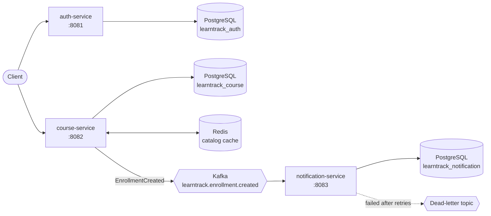

# LearnTrack

A course-enrollment platform built as Spring Boot microservices: JWT authentication, PostgreSQL, Redis caching, and Kafka event-driven notifications. A React frontend is in progress.

**Tech stack:** Java 21 · Spring Boot 3 · Spring Security (JWT) · Spring Data JPA · PostgreSQL · Redis · Apache Kafka · Docker Compose · JUnit 5 · Mockito

## Architecture



auth-service issues JWTs; course-service validates them with the same signing key, so the services never call each other to check a login.

## Services
| Service | Port | Status | Purpose |
|---|---|---|---|
| auth-service | 8081 | Done | Registration, login, JWT issuing |
| course-service | 8082 | Done | Course catalog and enrollments (PostgreSQL + Redis cache-aside) |
| notification-service | 8083 | Done | Consumes Kafka enrollment events, idempotent, with a dead-letter topic |
| gateway | | Planned | Spring Cloud Gateway entry point |
| frontend | | Planned | React + TypeScript |

## Run locally
1. `cp .env.example .env` and fill in the values.
2. `docker compose up -d` to start PostgreSQL, Redis and Kafka.
3. Start each service in its own terminal (requires JDK 21 and Maven):
   - **macOS / Linux:** `set -a; source .env; set +a; cd auth-service && mvn spring-boot:run` (repeat for `course-service` and `notification-service`)
   - **Windows:** `powershell -ExecutionPolicy Bypass -File .\dev.ps1 auth-service` (selects JDK 21 and loads `.env`)
4. Run tests with `mvn test` in each service folder (no database or Kafka needed; tests use mocks).

## Auth API (auth-service, 8081)
| Method | Path | Auth | Description |
|---|---|---|---|
| POST | /api/auth/register | Public | Create a student account |
| POST | /api/auth/login | Public | Returns a JWT |
| GET | /api/auth/me | Bearer token | Current user's profile |

## Course API (course-service, 8082)
| Method | Path | Auth | Description |
|---|---|---|---|
| GET | /api/courses | Public | Course catalog (cached in Redis) |
| GET | /api/courses/{id} | Public | One course (cached in Redis) |
| POST | /api/courses | INSTRUCTOR | Create a course |
| PUT | /api/courses/{id} | INSTRUCTOR (owner) | Update a course |
| POST | /api/courses/{id}/enrollments | STUDENT | Enroll in a course |
| GET | /api/enrollments/me | Bearer token | My enrollments |
| PATCH | /api/enrollments/{id}/progress | Bearer token (owner) | Update progress 0–100 |

## Design notes
- **Database per service:** each service owns its own PostgreSQL database, so no service reads another's tables.
- **Cache-aside with Redis:** reads check Redis first, fall back to PostgreSQL on a miss, then cache the result for 10 minutes. Writes evict the affected keys after the transaction commits. If Redis is down, reads fall back to the database.
- **Event-driven notifications with Kafka:** enrolling publishes an `EnrollmentCreated` event to `learntrack.enrollment.created`, but only after the database transaction commits, so a rolled-back enrollment never produces an event. Events are plain JSON keyed by student email, so one student's events stay in order and services share no Java classes.
- **Idempotent consumer:** Kafka delivers at least once, so notification-service records each `eventId` in a `processed_events` table (primary key) in the same transaction as the notification. A redelivered event is skipped.
- **Retries and dead-letter topic:** a failing message is retried 3 times, 1 second apart, then moved to `learntrack.enrollment.created.DLT`. Malformed messages skip retries and go straight to the DLT.
- **Known trade-off:** if Kafka is down at the moment after commit, that event is lost. The production fix is the transactional outbox pattern.
- **Duplicate enrollments** are blocked by an application check and by a database unique constraint, which catches two simultaneous requests.

## Making an instructor account
Registration always creates STUDENT accounts. To promote one for testing:
```bash
docker exec -it learntrack-postgres psql -U learntrack -d learntrack_auth \
  -c "UPDATE users SET role='INSTRUCTOR' WHERE email='teacher@example.com';"
```
Then log in again, because the role is stored inside the token.
